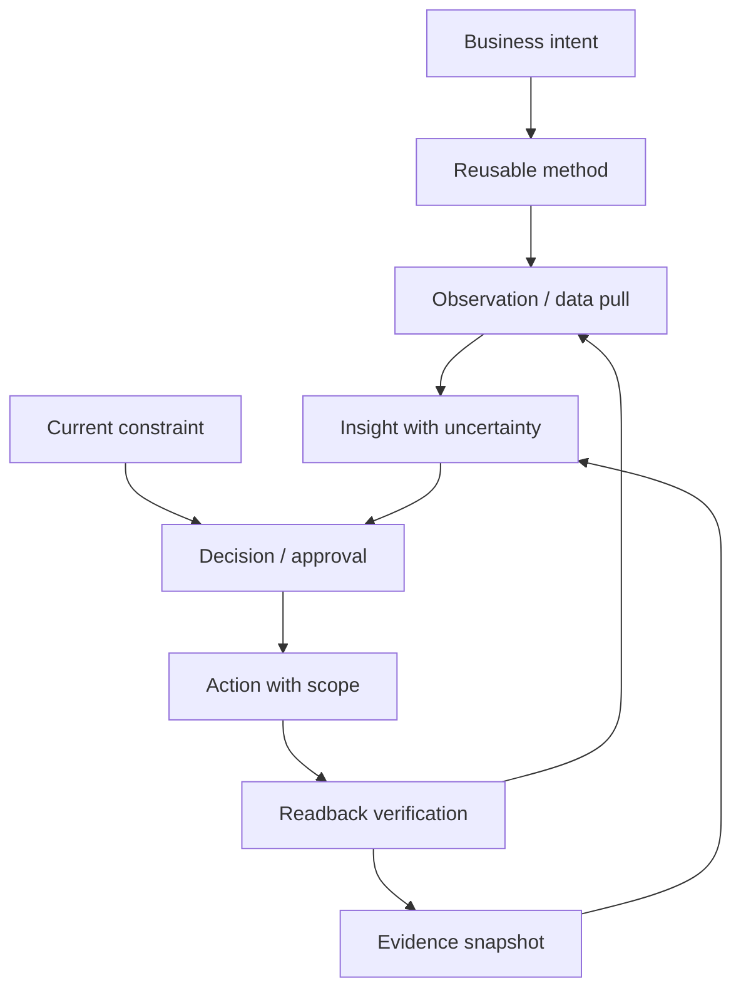

# Knowledge architecture: from conversation to evidence-backed execution

## 1. Six layers (do not flatten)

1. **Business intent** (`business-model`): What the business optimizes; experimentation objectives may differ from operating profit.
2. **Methodology** (`methods`): Portable decision procedures and their applicability limits; not live settings.
3. **Concrete constraints** (`state/constraints.yaml`): Authorizations, spend limits, platform eligibility, geographic targeting, SKU fulfillment limits, policy restrictions; effective dates and scope required.
4. **Observations / insights** (`records/insights`): Verifiable claims with exact metric units, source, time window, uncertainty, and competing interpretations.
5. **Decisions / experiments** (`records/decisions`, future `experiments/`): What was chosen, why, alternatives, approval, stop gates, and superseding changes.
6. **Action logs / evidence** (`records/runs`, external evidence referenced in `records/chronology.md`): Append-only execution and readback proof. Historical actions never substitute for current API state.

## 2. Provenance and evidence strength

Maintain two independent fields:
- **claim_status**: `HYPOTHESIS`, `OBSERVED`, `VERIFIED`, `INCONCLUSIVE`, `REJECTED`, `SUPERSEDED`.
- **implementation_status**: `PROPOSED`, `APPROVED`, `EXECUTED`, `READBACK_VERIFIED`, `BLOCKED`, `ROLLED_BACK`.

Also record `scope`: product, campaign, country, time period, system version, eligibility policy. A finding can be VERIFIED for one test without generalizing to all users.

Source evidence classes: `official_doc`, `direct_platform_raw_api`, `connector_readback`, `query_snapshot`, `browser_observation`, `shopifyql_report`, `user_agent_report`, `model_derived`, `external_market_source`.

A high-level connector summary and a raw platform field can disagree; never silently choose one. Save both readings and label conflict. Compare field names, semantics, freshness and units. Do not assume one always trumps the other.

## 3. Agent retrieval and use

At task start: read `AGENTS.md` → classify intent (analyze / recommend / change) → load relevant method → load current scoped constraints (stored records are historical, not live permissions) → query live system → check evidence and data freshness → propose action → check approval → execute → read back → append evidence, decision and action records.

The GitHub repository is a **knowledge source**; external platform APIs are the **current operational state source**. Never use an old Git commit to infer current campaign eligibility, shipping discount, budget or ad approval.

## 4. Knowledge promotion

Run log → diagnostic observation → validated insight → durable method/constraint. Only promote after repeated evidence or robust mechanism verification. If an insight is overturned, add `superseded_by`/`contradicted_by`, do not rewrite history. Superseded decisions remain queryable.

## 5. Two explicit clocks

Store both `captured_at_utc` and `business_date` with `business_timezone`. Store source-account timezone and currency. Date-limited campaigns and discount deadlines must preserve the local-wall-time interpretation alongside UTC.
